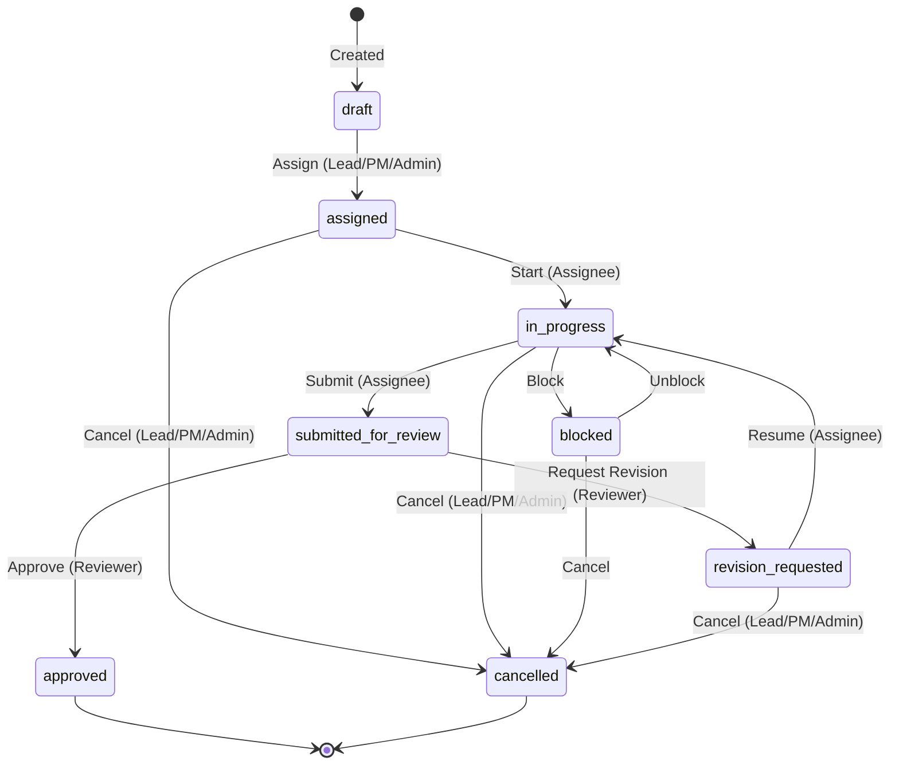
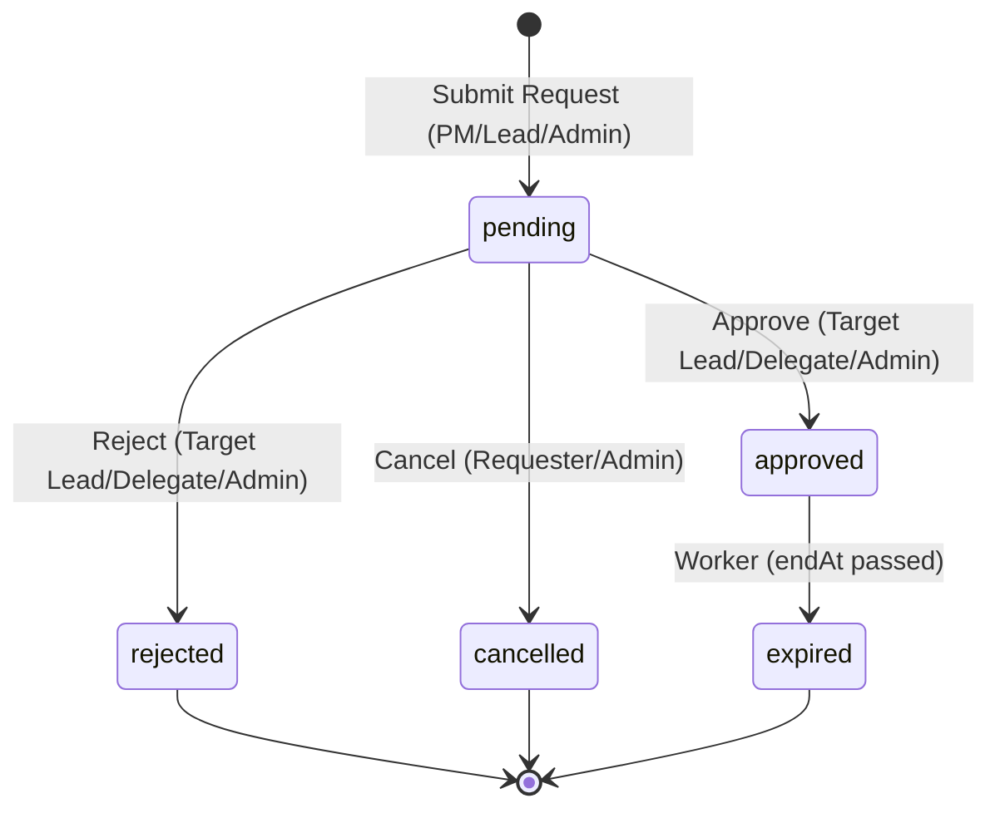
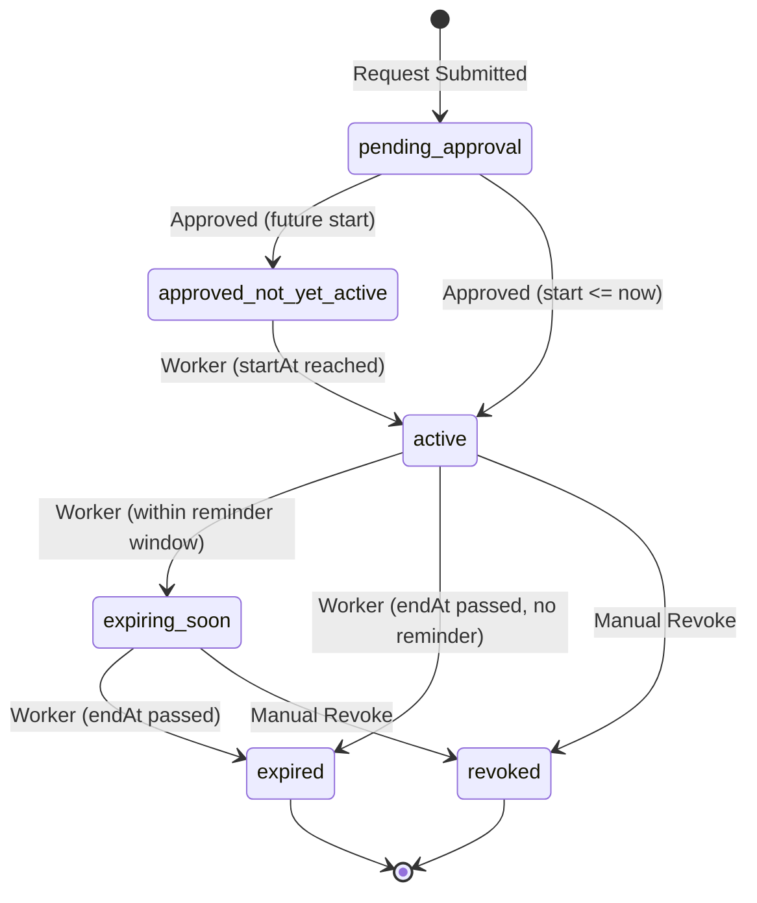
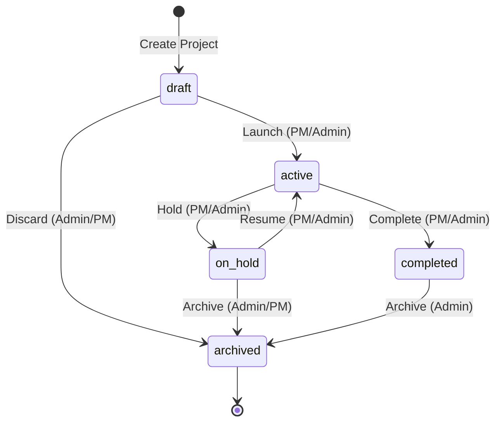

# TeamConnect — State Machines

> Every state transition is validated in the backend policy layer.
> The frontend renders transition buttons based on the current state and user role,
> but the API enforces all guards.

---

## 1. Task State Machine

### States

| State | Color Token | Icon | Description |
|-------|-------------|------|-------------|
| `draft` | slate | circle-dashed | Created but not yet assigned |
| `assigned` | indigo | user-check | Assigned to a user; awaiting start |
| `in_progress` | sky | loader | Assignee is working on it |
| `submitted_for_review` | amber | send | Assignee submitted; awaiting reviewer action |
| `revision_requested` | orange | rotate-ccw | Reviewer requested changes; back with assignee |
| `approved` | emerald | check-circle-2 | Reviewer approved; task complete |
| `blocked` | rose | ban | Dependency or external blocker |
| `cancelled` | slate | x-circle | Cancelled by Lead/PM/Admin |

### Transition Table

| From | To | Actor | Guard |
|------|----|-------|-------|
| `draft` | `assigned` | Lead/PM/Admin | Task has assignee |
| `assigned` | `in_progress` | Assignee | — |
| `assigned` | `cancelled` | Lead/PM/Admin | — |
| `in_progress` | `submitted_for_review` | Assignee | At least one submission version exists |
| `in_progress` | `blocked` | Assignee / Lead / PM / Admin | Reason required |
| `in_progress` | `cancelled` | Lead/PM/Admin | — |
| `blocked` | `in_progress` | Assignee / Lead / PM / Admin | — |
| `blocked` | `cancelled` | Lead/PM/Admin | — |
| `submitted_for_review` | `revision_requested` | Reviewer (Lead/Delegate/PM/Reviewer) | Remarks required; reviewer != assignee |
| `submitted_for_review` | `approved` | Reviewer | reviewer != assignee |
| `revision_requested` | `in_progress` | Assignee | — |
| `revision_requested` | `cancelled` | Lead/PM/Admin | — |
| `approved` | — | — | Terminal state; no further transitions |
| `cancelled` | — | — | Terminal state |

### Mermaid Diagram

---

## 2. Cross-Category Request State Machine

### States

| State | Color Token | Icon | Description |
|-------|-------------|------|-------------|
| `pending` | amber | clock | Submitted; awaiting target lead/delegate action |
| `approved` | emerald | check-circle-2 | Approved; membership created (may not be active yet) |
| `rejected` | rose | x-circle | Rejected by target lead/delegate |
| `cancelled` | slate | x-circle | Cancelled by requester before decision |
| `expired` | slate | calendar-x | Membership end date passed; membership state transitioned |

### Transition Table

| From | To | Actor | Guard |
|------|----|-------|-------|
| — | `pending` | PM/Lead/Admin | No existing pending request for same (project, targetUser) |
| `pending` | `approved` | Target Lead / Active Delegate (approve_request) / Admin | No other approve/reject has landed simultaneously (race guard) |
| `pending` | `rejected` | Target Lead / Active Delegate (approve_request) / Admin | Rejection reason required |
| `pending` | `cancelled` | Requester / Admin | Request still pending |
| `approved` | `expired` | System Worker | Membership endAt < now |

### Mermaid Diagram

---

## 3. Membership State Machine

### States

| State | Color Token | Icon | Description |
|-------|-------------|------|-------------|
| `pending_approval` | amber | clock | Request created; not yet approved |
| `approved_not_yet_active` | sky | calendar | Approved but startAt > now |
| `active` | emerald | shield-check | startAt <= now < endAt AND not revoked |
| `expiring_soon` | amber | alert-triangle | Active but endAt within reminder window (default 7 days) |
| `expired` | slate | calendar-x | endAt < now |
| `revoked` | rose | shield-off | Manually revoked before expiry |

### Transition Table

| From | To | Trigger | Guard |
|------|----|---------|-------|
| — | `pending_approval` | Request submitted | — |
| `pending_approval` | `approved_not_yet_active` | Request approved + startAt > now | — |
| `pending_approval` | `active` | Request approved + startAt <= now | — |
| `approved_not_yet_active` | `active` | Worker: startAt <= now | — |
| `active` | `expiring_soon` | Worker: endAt - now <= reminderDays | — |
| `expiring_soon` | `expired` | Worker: endAt < now | — |
| `active` | `expired` | Worker: endAt < now | — |
| `active` | `revoked` | Lead (target cat) / PM / Admin | Revocation reason required |
| `expiring_soon` | `revoked` | Lead / PM / Admin | Reason required |
| `expired` | — | — | Terminal |
| `revoked` | — | — | Terminal |

> **Renewal:** A renewal request creates a NEW membership record with a new time range.
> The old membership remains expired/revoked. The renewal request goes through `pending` -> `approved` -> new membership active.

### Mermaid Diagram

---

## 4. Project State Machine

### States

| State | Color Token | Icon | Description |
|-------|-------------|------|-------------|
| `draft` | slate | file-edit | Being set up; not yet launched |
| `active` | emerald | play-circle | In execution |
| `on_hold` | amber | pause-circle | Temporarily paused |
| `completed` | sky | check-circle-2 | All deliverables accepted |
| `archived` | slate | archive | Closed; read-only |

### Transition Table

| From | To | Actor | Guard |
|------|----|-------|-------|
| — | `draft` | PM with canCreateProject / Lead / Admin | Required fields present |
| `draft` | `active` | PM / Admin | At least one member; PM assigned |
| `draft` | `archived` | Admin / PM | — |
| `active` | `on_hold` | PM / Admin | Reason required |
| `active` | `completed` | PM / Admin | — |
| `on_hold` | `active` | PM / Admin | — |
| `on_hold` | `archived` | Admin / PM | — |
| `completed` | `archived` | Admin | — |
| `archived` | — | — | Terminal (no transitions out) |

### Mermaid Diagram

---

## 5. Delegation State Machine

| State | Description |
|-------|-------------|
| `active` | Effective now; delegate can exercise allowlisted permissions |
| `expired` | effectiveTo < now (auto-expired by worker) |
| `revoked` | Manually revoked by primary lead or admin |

Transitions: `active` → `expired` (worker) or `active` → `revoked` (manual).

---

## 6. Submission Version Model

Submissions are versioned (v1, v2, ...) within a task.
Each version has state: `pending_review` | `revision_requested` | `accepted`.
The LATEST submission version drives the task state.
Previous versions are immutable and preserved in history.
